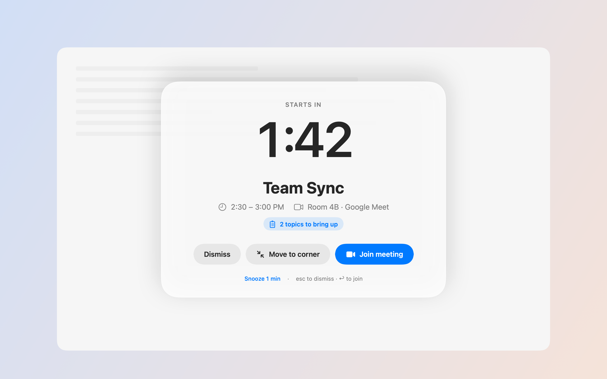
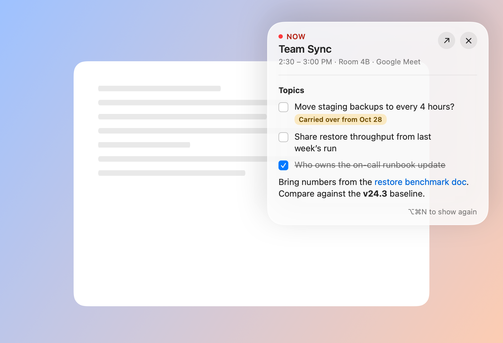
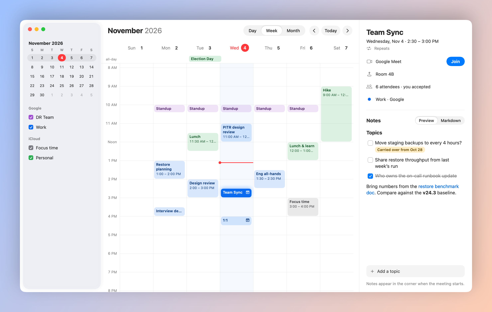

# MeetCue

A macOS menu bar app that keeps your next meeting in view, so you don't lose track of time and end up late.

MeetCue is in early development (version 0.1.0). It isn't on the App Store; you build it yourself from source, as described below.



## What it does today

- **Your next meeting in the menu bar.** More than an hour out it shows the start time (`2:30 PM · Team Sync`). Within the hour it counts down (`in 24m`), and during the meeting it shows the time left (`12m left`, or `1h 20m left` for long ones). Titles longer than 10 characters scroll as the meeting approaches. Press ⌥⌘J from any app to join the meeting it shows.
- **A dropdown with the details.** The meeting's time, location and video service together (`Room 4B · Google Meet`), and a **Join meeting** button for Zoom, Google Meet and Microsoft Teams links. Links found in the event's URL, location or notes all work.
- **A full-screen alert before each meeting.** Two minutes before the start it covers every display with a live countdown, Join, Snooze and Dismiss. Move it to the corner and it shrinks to a countdown pill.
- **Notes on any meeting.** Open MeetCue (⌥⌘O) for a day, week or month calendar, pick a meeting, and write Markdown notes. Task items (`- [ ] Budget for Q1`) are topics to bring up; add one quickly from the dropdown's **Add a topic** field. Topics you didn't tick off move to the next occurrence of a recurring meeting, tagged "Carried over".
- **A notes card when the meeting starts.** It shows the meeting's notes in the corner, with checkboxes you can tick during the call. Drag it by its header if it covers something, or collapse it to a small bar and expand it again later. Hide it with ×; ⌥⌘N or **Show notes card** brings it back.
- **Quiet mode.** Turn it on for an hour, until the end of the day, or until you turn it off. The menu bar shows a moon while it's on, and the full-screen alert stays away; the notes card still appears.
- **Follows your Mac.** It reads every calendar you've added to macOS Calendar (iCloud, Google, Exchange), skips meetings you've declined, and follows the macOS 24-hour time setting.
- **Google Calendar, optionally.** Connect a Google account in Settings › Calendars to see the meetings on its primary calendar, with their Meet links and your replies, even if the account isn't on your Mac. A meeting that's on both shows once. MeetCue only reads your events, and needs a build with a Google client ID (see [Google sign-in](#google-sign-in)).
- **Settings.** Open them from the dropdown's **Settings…** item, or press ⌘, while the dropdown or a MeetCue window is open. Choose the alert's lead time, snooze length, sound and displays; when the notes card appears; which calendars show and which alert; what the menu bar shows and how titles scroll; whether notes open in Preview or Markdown; light or dark mode and how opaque the glass is. Turn on launch at login, and export every note as a Markdown file.

<p>
  
  
</p>

## Requirements

- macOS 26 (Tahoe) or later
- Xcode 26, with its license accepted (`sudo xcodebuild -license accept`) and selected as the active developer directory:

  ```bash
  sudo xcode-select --switch /Applications/Xcode.app/Contents/Developer
  ```

- [XcodeGen](https://github.com/yonaskolb/XcodeGen), which generates the Xcode project from `project.yml`:

  ```bash
  brew install xcodegen
  ```

## Build and run locally

1. Clone the repository and generate the Xcode project:

   ```bash
   git clone https://github.com/kev-cao/MeetCue.git
   ```

   ```bash
   cd MeetCue && xcodegen generate
   ```

2. Build a Release copy of the app:

   ```bash
   xcodebuild -project MeetCue.xcodeproj -scheme MeetCue -configuration Release -destination 'platform=macOS' -derivedDataPath build/DerivedData build
   ```

3. Copy it to your Applications folder and open it:

   ```bash
   cp -R build/DerivedData/Build/Products/Release/MeetCue.app /Applications/
   ```

   ```bash
   open /Applications/MeetCue.app
   ```

MeetCue has no Dock icon while its windows are closed; look for it in the menu bar. On first launch macOS asks for access to your calendars. Click **Allow**, and your next meeting appears. If you denied access, open the dropdown and click **Open Privacy Settings**, or go to System Settings › Privacy & Security › Calendars.

To quit, open the dropdown and click **Quit** (or press ⌘Q while it's open).

**Start at login:** turn on **Launch at login** in MeetCue's Settings › General.

### Calendar access after rebuilding

The project signs the app ad hoc, so you don't need an Apple developer account. The catch is that macOS ties the calendar permission to that exact build, and may ask again after you rebuild. To keep the permission across builds, sign with your free personal team: in `project.yml`, replace

```yaml
    CODE_SIGN_IDENTITY: "-"
    CODE_SIGN_STYLE: Manual
```

with your team ID (shown in Xcode › Settings › Accounts):

```yaml
    DEVELOPMENT_TEAM: YOUR_TEAM_ID
    CODE_SIGN_STYLE: Automatic
```

then run `xcodegen generate` and build again.

### Google sign-in

Connecting a Google account needs an OAuth client ID, which isn't in the repository. Builds without one work the same, minus the **Connect** button. To add yours:

1. In the [Google Cloud console](https://console.cloud.google.com/), create a project and turn on the **Google Calendar API**.
2. Set up the consent screen (Google Auth Platform) and add the scope `https://www.googleapis.com/auth/calendar.events.readonly`. With an **External** audience, add yourself as a test user.
3. Create an OAuth client of type **iOS** with the bundle ID `io.github.kev-cao.MeetCue`.
4. Copy the example config and put the client ID in it:

   ```bash
   cp Config/Google.example.xcconfig Config/Google.xcconfig
   ```

   ```
   GOOGLE_CLIENT_ID = 1234567890-abc123.apps.googleusercontent.com
   ```

5. Run `xcodegen generate` and build again.

`Config/Google.xcconfig` is ignored by git. The sign-in token is kept in your login keychain; with the ad hoc signing above, macOS may ask to let MeetCue use it after a rebuild.

## Running the tests

The decision logic lives in the `MeetCueCore` Swift package and has its own test suite:

```bash
cd MeetCueCore && swift test
```

The app's tests (the meeting store, quiet mode, the menu bar model, and view snapshots) run through Xcode:

```bash
xcodebuild -project MeetCue.xcodeproj -scheme MeetCue -destination 'platform=macOS' -derivedDataPath build/DerivedData test
```

The tests launch the app as their host but skip its setup, so they never ask for calendar access.

The README screenshots are rendered by a test suite that runs only when you give it a folder:

```bash
TEST_RUNNER_MEETCUE_README_DIR="$PWD/.github/assets" xcodebuild -project MeetCue.xcodeproj -scheme MeetCue -destination 'platform=macOS' -derivedDataPath build/DerivedData test -only-testing:MeetCueTests/ReadmeImageTests
```

## Project layout

```
project.yml                XcodeGen spec for the app and its tests
App/MeetCue/               the app: EventKit loading, Google sign-in and calendar fetching,
                           menu bar item and dropdown, alerts and the notes card, notes
                           storage, the calendar window, settings
Config/                    build settings; Google.xcconfig (yours, untracked) holds the client ID
App/MeetCueTests/          app tests
MeetCueCore/               Swift package with the decision logic and its tests:
                           meetings, video links, filtering, menu bar text,
                           alert rules, Markdown topics, carry-over and export names,
                           Google event mapping, OAuth requests and merging
```

## Privacy

MeetCue reads your calendars on your Mac through Apple's EventKit and never changes them. Notes stay on your Mac, in `~/Library/Application Support/MeetCue`. If you connect a Google account, MeetCue reads that account's events from Google with read-only access, keeps them in memory only, and stores the sign-in token in your keychain. Nothing else is sent anywhere.
